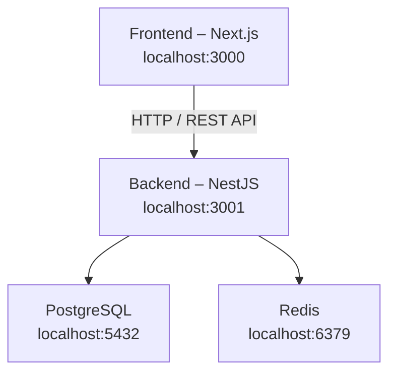

# Các port Localhost cơ bản dành cho Intern Developer

Tài liệu tổng hợp các cổng (port) phổ biến khi dựng môi trường Local cho Frontend, Backend, Database và các dịch vụ hỗ trợ.

## 1. Frontend – Giao diện

| Địa chỉ Local | Công nghệ thường sử dụng |
| --- | --- |
| `http://localhost:3000` | React, Next.js, Node.js |
| `http://localhost:3001` | Frontend hoặc Backend bổ sung |
| `http://localhost:4200` | Angular |
| `http://localhost:5173` | Vite, React, Vue.js |
| `http://localhost:5174` | Vite khi port 5173 bị chiếm |
| `http://localhost:8080` | Vue CLI, Web Server |
| `http://localhost:5500` | VS Code Live Server |
| `http://localhost:4321` | Astro |
| `http://localhost:13000` | Port tùy chỉnh, ví dụ NocoBase |

## 2. Backend – Máy chủ xử lý

| Địa chỉ Local | Công nghệ thường sử dụng |
| --- | --- |
| `http://localhost:3000` | NestJS, ExpressJS |
| `http://localhost:4000` | Node.js API, GraphQL |
| `http://localhost:5000` | Python Flask, .NET |
| `http://localhost:5001` | .NET hoặc Backend bổ sung (có thể dùng HTTPS) |
| `http://localhost:8000` | Django, FastAPI, Laravel |
| `http://localhost:8080` | Java Spring Boot |
| `http://localhost:8888` | Jupyter Notebook |

## 3. Database – Cơ sở dữ liệu

| Host và Port | Công nghệ |
| --- | --- |
| `localhost:3306` | MySQL, MariaDB |
| `localhost:5432` | PostgreSQL |
| `localhost:27017` | MongoDB |
| `localhost:6379` | Redis |
| `localhost:1433` | Microsoft SQL Server |
| `localhost:1521` | Oracle Database |
| `localhost:9200` | Elasticsearch |
| `localhost:8123` | ClickHouse HTTP |

Database thường được kết nối bằng phần mềm quản lý hoặc thư viện lập trình, không phải trực tiếp bằng trình duyệt.

## 4. Các dịch vụ hỗ trợ

| Địa chỉ / Port | Dịch vụ |
| --- | --- |
| `localhost:80` | HTTP |
| `localhost:443` | HTTPS |
| `localhost:22` | SSH |
| `localhost:5672` | RabbitMQ |
| `localhost:15672` | RabbitMQ Management |
| `localhost:9092` | Apache Kafka |
| `localhost:9090` | Prometheus |
| `localhost:3000` | Grafana |
| `localhost:9000` | MinIO API |
| `localhost:9001` | MinIO Console (khi cấu hình port này) |
| `localhost:11434` | Ollama AI |
| `localhost:8025` | Mailpit Web UI |

## 5. Mô hình Local của một dự án Full-stack



## 6. Các lệnh kiểm tra port trên Windows

**Kiểm tra tất cả port đang sử dụng:**

```cmd
netstat -ano
```

**Kiểm tra port 3000:**

```cmd
netstat -ano | findstr :3000
```

**Kiểm tra tiến trình đang sử dụng port theo PID:**

```cmd
tasklist /FI "PID eq 1234"
```

**Dừng tiến trình theo PID (chỉ khi đã xác định đúng tiến trình):**

```cmd
taskkill /PID 1234 /F
```

Thay `1234` bằng PID thực tế.

**Kiểm tra các Docker Container và port:**

```bash
docker ps
docker compose ps
```

## 7. Phân biệt các địa chỉ mạng cơ bản

| Địa chỉ | Ý nghĩa |
| --- | --- |
| `localhost` | Truy cập máy tính hiện tại |
| `127.0.0.1` | Địa chỉ IPv4 loopback |
| `::1` | Địa chỉ IPv6 loopback |
| `0.0.0.0` | Lắng nghe trên tất cả giao diện IPv4 |
| `192.168.x.x` | Địa chỉ IP mạng nội bộ thường gặp |
| `10.x.x.x` | Địa chỉ IP mạng riêng |
| `domain.com` | Truy cập thông qua tên miền |

> **Lưu ý:** Port không quyết định công nghệ của dự án. Ví dụ, Next.js hoàn toàn có thể chạy trên port 13000 thay vì 3000. Các port trong tài liệu là những giá trị phổ biến hoặc ví dụ cấu hình, không phải quy định bắt buộc.
>
> Khi dựng Local, cần kiểm tra `README.md`, `.env`, `package.json`, `Dockerfile` và `docker-compose.yml` hoặc `compose.yml` để xác định port chính xác. Không phải mọi port đều cung cấp giao diện HTTP để truy cập bằng trình duyệt.
